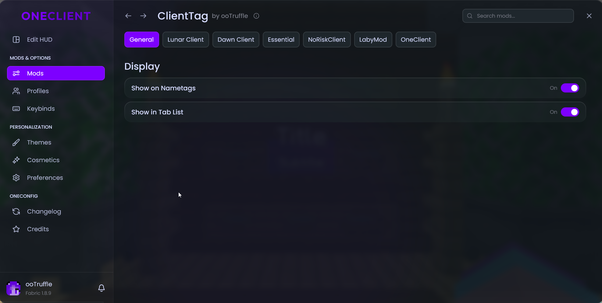

# Client Tag 

# AI Disclosure
This is HEVALY vibecoded mod to cleanroom the various websockets, feel free to pr to clean up the code^^

# What this Mod is

This is a mod to allow you to see client indicators for vaious clients without needing to be on said client

This mod can be used standalone (it Pulls fabric-api) however its recomended to have [OneConfig](https://github.com/Polyfrost/OneConfig) installed as it provides ingame config menus

# Flagging Players

You can flag players for your own reasons. They get a warning triangle by their name, and chat tells you (with your reason) when one of them is on the same server as you. Flags stay on your computer, in `config/clienttag/flags.json`, and are never shared.

- `/clienttag flag <player> [reason]` - flag a player, or change their reason
- `/clienttag unflag <player>` - remove a flag
- `/clienttag flags` - list everyone you've flagged

The commands need OneConfig. Without it you can still edit `flags.json` by hand while the game is closed. The triangle and the chat alerts can be turned off or recolored in the "Flagged Players" tab of `/clienttag`.

# Warning

This mod possibly breaks various services TOS, by installing this mod you agree that you may get your account banned on these services