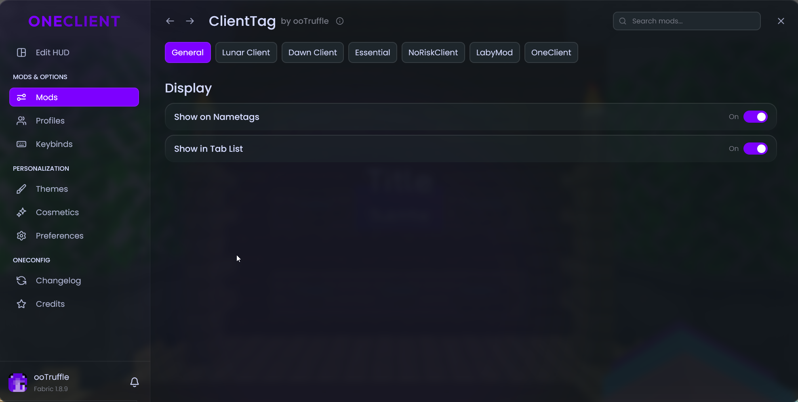

# Client Tag 

# AI Disclosure
This is HEVALY vibecoded mod to cleanroom the various websockets, feel free to pr to clean up the code^^

# What this Mod is

This is a mod to allow you to see client indicators for vaious clients without needing to be on said client

This mod can be used standalone (it Pulls fabric-api) however its recomended to have [OneConfig](https://github.com/Polyfrost/OneConfig) installed as it provides ingame config menus

# Flagging Players

You can flag players for your own reasons. They get a warning triangle by their name, and chat tells you (with your reason) when one of them shows up on your server, and again if they come back after a minute or more away. Flags stay on your computer, in `config/clienttag/flags.json`, and are never shared.

- `/clienttag flag <player> [reason]` - flag a player, or change their reason
- `/clienttag unflag <player>` - remove a flag
- `/clienttag flags` - list everyone you've flagged

`/ct` works as a short form of `/clienttag` everywhere. The commands need OneConfig. Without it you can still edit `flags.json` by hand while the game is closed. The "Flagged Players" tab of `/clienttag` also lists everyone you've flagged, one `name reason` row each: edit a reason, delete a row or add one, and the changes apply when you close the settings. The triangle and the chat alerts can be turned off or recolored there too.

# Previewing Icons

`/clienttag debug <player>` shows every client's icon by a player in the tab list or nearby, as if they were on all of them, so you can see how the icons look and line up with your order and colors. Run it again to turn it off for them, or `/clienttag debug` to turn it off for everyone. Only you see it, nothing is sent anywhere, and it's forgotten when the game closes.

# The ClientTag Server

ClientTag tells the ClientTag server which client you're really on, so other ClientTag users see your real tag rather than every client's. It also tells the server which clients it has seen other players on, for statistics of which clients people use. Turn either off in the "ClientTag Server" section of `/clienttag` ("Use ClientTag Server" turns off both, "Share Spotted Clients" just the second). See [server/README.md](server/README.md) for what the server keeps.

# Warning

This mod possibly breaks various services TOS, by installing this mod you agree that you may get your account banned on these services